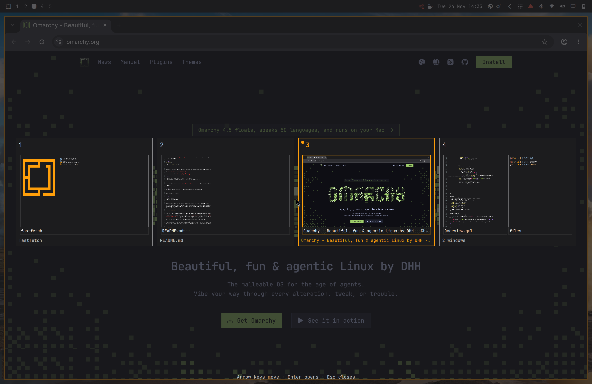

# Omarview

Mission Control for [Omarchy](https://omarchy.org/). One overlay shows your workspaces and the windows on them, with a live picture of each window.



## Install

```sh
omarchy plugin add https://github.com/ergofobe/omarview.git --enable
```

That clones this repo into `~/.config/omarchy/plugins/ergofobe.omarview` and enables it. The plugin does not change Hyprland config. The keys and the hot corner below are optional, and each one is a line you add yourself.

Bind the keys in `~/.config/hypr/bindings.lua`:

```lua
o.bind("F3", "Omarview", { panel = "ergofobe.omarview" })
o.bind("XF86LaunchA", "Omarview", { panel = "ergofobe.omarview" })
```

On a Mac keyboard the F3 key sends `XF86LaunchA` unless Fn is held, so both keys are bound.

Load the hot corner from `~/.config/hypr/hyprland.lua`, after the Omarchy defaults:

```lua
dofile(os.getenv("HOME") .. "/.config/omarchy/plugins/ergofobe.omarview/hypr/omarview.lua")
```

Then check the config:

```sh
hyprctl reload
hyprctl configerrors
```

Arrow keys move between workspaces and windows, Enter opens the selection, and Esc closes the view. Click a window to focus it, or click the empty area around the cards to close.

The corner is the top 8 logical pixels of the right edge. It waits about a fifth of a second before opening, and it does not fire again until the pointer leaves. If the pointer is already in the corner when Hyprland reloads, the overview stays closed.

## Live previews

Each tile is a Hyprland toplevel capture. While the overview is open, Omarview asks every window to keep drawing (`render_unfocused`) and raises `misc.render_unfocused_fps` to 30. A one-pixel pulse in the overlay makes the monitor commit, which is what delivers the next frame. Closing the overview restores the previous frame rate and turns the window flag back off.

A window that refuses to draw while it is covered will stay on its last frame. That is the client, not the capture. Copies are full size for as long as the overview is open.

Omarview needs no packages beyond Omarchy.

## Remove

Take the key bindings and the `dofile` line back out of the Hyprland config, then:

```sh
omarchy plugin remove ergofobe.omarview
```

## License

Apache License 2.0. See [LICENSE](LICENSE).
